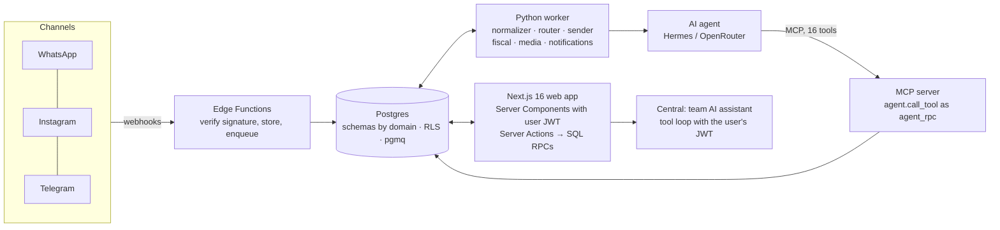

<div align="center">

# 🛒 CentralOps (CetraOps)

### Retail ERP + omnichannel inbox + AI agents, built on Postgres

*Everything a fashion store needs, from the point of sale to the ledger, with an AI assistant that works through safe, audited tools.*


</div>

---

## What is it?

**CentralOps** is the operations hub for fashion retail stores, including a *shop-in-shop* model inside a partner gym and
network expansion. It has two fronts sharing one foundation:

- **Retail ERP**: point of sale, size-grid inventory, NFC-e (Brazilian fiscal receipts), double-entry accounting with cost
  allocation at settlement, bank reconciliation, purchasing with NF-e, HR tied to payroll/accounting/tax, and tax compliance
  (Simples Nacional / DAS / eSocial).
- **Omnichannel + AI**: a single inbox (WhatsApp, Instagram, Telegram), an AI agent with safe tools (Hermes Agent /
  OpenRouter), instant AI ↔ human handover, and a CRM linked to purchases.

> The original prototype (Python/JSON) was frozen and is not published. Reconstruction decisions are recorded in
> [`docs/adr`](docs/adr).

## 🧠 Design principles

1. **Postgres is the system of record and the bus.** Invariants live in transactional SQL functions; external effects go
   through an outbox / `pgmq` queues. Row-Level Security is on every table.
2. **The agent is not a system of record.** It is called statelessly; history, memory and orders live in the database.
   Every agent call goes through `agent.call_tool` under a restricted role (`agent_rpc`) with a signed context token.
3. **Humans stay in control.** Confirmation cards for sensitive actions; AI ↔ human takeover at any time.
4. **Everything is tested close to the data**: ~1,700 pgTAP tests (RLS, ledger, inventory, HR, tax, message pipeline,
   privileges, cron) plus Python, Edge and TypeScript suites, all run in CI.

## 🏗️ Architecture



```text
apps/web            Next.js 16 (App Router) + TypeScript + Tailwind
  lib/central/       "Central", the team's AI assistant: server-side tool loop with the caller's JWT, confirmation cards, document reading
apps/worker         Python (psycopg 3 async): consumes pgmq queues
apps/agent/
  contract/         agent contract: context token (JWT), tool profiles, schemas (shared by worker and MCP)
  mcp_server/       MCP server (StreamableHTTP) exposing the agent's 16 tools
supabase/
  migrations/       the whole data model and business rules (transactional SQL functions)
  functions/        webhook-ingest Edge Functions (Meta, Telegram)
  seed/ · tests/    configuration and fictional dev seeds · pgTAP tests
packages/db         TypeScript types generated from the database
packages/domain     shared rules (money, commission, allocation, menu)
infra/              production compose (Coolify/Traefik), VPS hardening, backups, runbook
```

## 📦 Modules

| Area | Status |
|---|---|
| **Sell**: multi-payment POS, remote orders, reservations and VIP closet, exchanges/returns, deliveries, cash register, coupons | ✅ ready |
| **Products & Inventory**: size-grid catalog, ledger-style stock, import, purchasing, NF-e receiving with grid conferencing, replenishment | ✅ ready |
| **Finance**: payables/receivables, settlement with **allocation at payment**, general ledger, P&L, cash flow, recurring entries, budget, monthly close, contracts | ✅ ready |
| **Tax**: Simples/DAS, obligations, eSocial, received notes, **issued notes** (NFC-e via worker/Focus NFe: resend, cancel, paid sales without a note) | ✅ ready |
| **Settings**: integrations (credentials in Vault, tested by the worker), bank accounts, chart of accounts, allocations, card fees | ✅ ready |
| **Team (HR)**: hiring, schedules, time clock, vacations, payroll, termination, commissions, access, tied to finance/accounting/tax | ✅ ready |
| **Customer service**: inbox, AI drafts, Pilot / Copilot / Human modes, send window | 🟡 core ready |
| **Central (team AI)**: chat on every screen (top bar, Ctrl+/, Ctrl+K) with text, voice, camera (barcode, boleto, Pix, DANFE) and photo/PDF reading (IDs, boleto, invoices). Queries customers, products, stock, accounts, cash, P&L, cash flow | ✅ ready |
| **Intelligence**: per-task model routing, costs | 🟡 partial |
| **Customers / Marketing**: 360° profile, coupons | 🟡 partial |

## 🚀 Getting started

Requirements: Node 22, pnpm 10 (`corepack enable`), [uv](https://docs.astral.sh/uv/), Docker.

```bash
pnpm install
npx supabase start                # local Postgres + Auth + Realtime + Storage + Edge runtime
npx supabase db reset             # migrations + seeds (config + FICTIONAL dev data)
cp .env.example .env              # fill in what you need
pnpm --filter @centralops/web dev        # http://localhost:3000 (test users: supabase/seed/90_dev_demo.sql)
pnpm worker                       # worker that consumes the queues
```

Without AI keys the system still works: AI conversations fall back to human handling and the team assistant answers in
search mode. Drafting requires `CENTRALOPS_OPENROUTER_KEY` or `CENTRALOPS_HERMES_KEY`.

## ✅ Tests and quality

| Command | What it runs |
|---|---|
| `npx supabase test db` | pgTAP: ~1,700 tests (RLS, ledger, inventory, HR, tax, message pipeline, agent, privileges, cron) |
| `pnpm test:py` | agent contract + worker + MCP server (against local Postgres; each test runs in a rolled-back transaction) |
| `pnpm test:edge` | webhook functions (HMAC, idempotency keys) |
| `pnpm exec turbo run typecheck lint test` | TypeScript types, ESLint, Vitest |
| `pnpm lint:py` | Ruff |
| `npx supabase db lint --local --level error` | PL/pgSQL function checks |

**CI** (`.github/workflows/ci.yml`) runs all of it on every PR and builds the Docker images. **Release** (tag `vX.Y.Z`)
publishes, applies migrations to production **behind a manual approval** and deploys to Coolify. See
[`infra/README.md`](infra/README.md).

---

<div align="center">

Built by **Paulo Aragão Jr** · [GitHub](https://github.com/pjaragao) · [LinkedIn](https://www.linkedin.com/in/paulojrarj)

</div>
