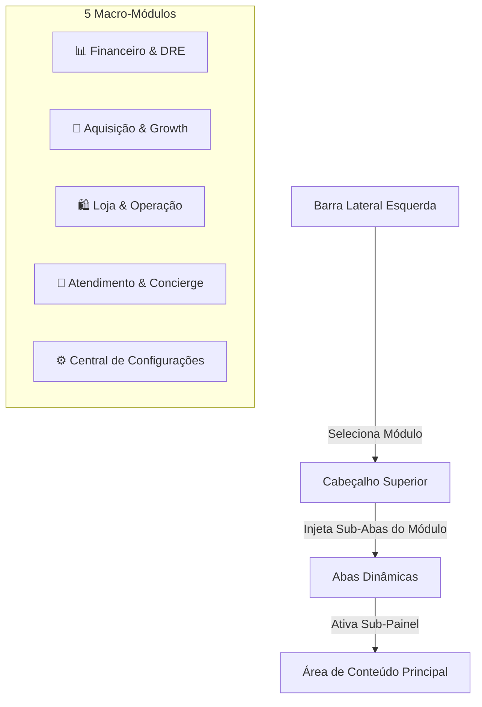

# 01 — Arquitetura de Navegação & Layout

> **SIÉ JOY OS — Sistema de Navegação Modular de Dois Níveis com Barra Lateral Retrátil**

---

## 🏛️ 1. Conceito Estrutural

O sistema adota uma arquitetura de navegação em dois níveis hierárquicos:
1. **Nível 1 (Macro-Módulos):** Selecionados na barra lateral esquerda (5 itens limpos, sem badges ou distrações visuais).
2. **Nível 2 (Sub-Abas Contextuais):** Renderizadas dinamicamente no cabeçalho superior (`.top-subnav`), exibindo apenas as sub-funcionalidades do módulo ativo.



---

## 📐 2. Barra Lateral Retrátil (Collapsible Sidebar)

A barra lateral (`#app-sidebar`) oferece dois modos de operação para maximizar a área útil de trabalho:

- **Modo Expandido (260px):**
  - Exibe o logotipo oficial da SIÉ Wear, selo de localização "Florianópolis/SC • Centro", ícone e rótulo completo de cada um dos 5 módulos.
  - Exibe o card de status do Terminal Stone POS no rodapé.
- **Modo Recolhido / Minimalista (76px):**
  - Esconde textos, legendas e badges via CSS (`.sidebar.collapsed .nav-item span:not(.nav-icon) { display: none; }`).
  - Centraliza os ícones com transição suave (`transition: width 0.3s cubic-bezier(0.4, 0, 0.2, 1)`).
  - Pode ser alternado tanto pelo botão no rodapé da barra (`#btn-sidebar-toggle`) quanto pelo botão no cabeçalho (`#btn-sidebar-toggle-top`).

---

## 🛡️ 3. Isolamento Estrito de Módulos (Container Isolation)

Para evitar problemas de sobreposição ou rolagem infinita, cada macro-módulo é encapsulado em uma tag `<section class="module-container">`:

```css
/* Isolamento de Módulos no CSS */
.module-container {
  display: none;
  animation: fadeInPane 0.25s ease-in-out;
}
.module-container.active {
  display: block;
}

/* Isolamento de Sub-Abas */
.module-subpane {
  display: none;
  animation: fadeInPane 0.25s ease-in-out;
}
.module-subpane.active {
  display: block;
}
```

Ao clicar em um módulo na barra lateral, o controlador mestre `switchModule(moduleKey)`:
1. Remove a classe `.active` de todos os containers e adiciona apenas ao `#module-${moduleKey}`.
2. Atualiza os títulos e subtítulos no cabeçalho superior.
3. Rola o scroll suavemente para o topo (`window.scrollTo({ top: 0, behavior: 'smooth' })`).
4. Reconstrói as abas superiores (`renderTopSubnav`) e ativa a sub-aba padrão do módulo.

---

## 🏷️ 4. Títulos das Abas Limpos e Padronizados

Conforme diretriz de design, **nenhum título de aba possui texto entre parênteses `()`**. Todos os termos foram sintetizados para máxima clareza:

| Módulo | Sub-Abas Oficiais |
| :--- | :--- |
| **Financeiro & DRE** | `Dashboard de KPIs`, `DRE Gerencial`, `Simulador de Cenários`, `Ponto de Equilíbrio` |
| **Aquisição & Growth** | `CRM & Funil`, `Extração de Leads`, `Meta Ads Granular`, `Playbook Anti-Ban` |
| **Loja & Operação** | `Frente de Caixa & Vendas`, `Terminal PDV Stone`, `Catálogo & Estoque`, `Planejamento de Compras`, `Drops & Eventos`, `Joy Trainers VIP` |
| **Atendimento & Concierge** | `Herme Agent IA`, `WhatsApp Concierge`, `Armário VIP`, `Insights de Varejo` |
| **Configurações** | `Central de Integrações`, `Regras de Qualificação`, `Parâmetros da Boutique` |
