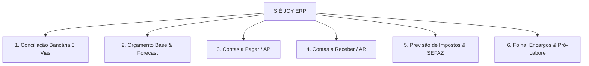
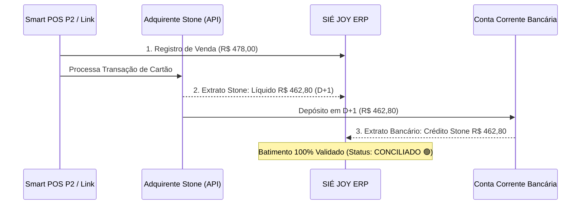
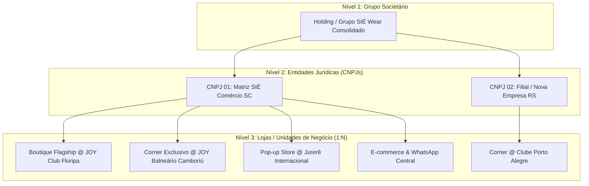

# 07 — Plano Estratégico de Expansão: SIÉ JOY ERP Corporativo

> **Roteiro de Implementação de Funcionalidades ERP de Alta Robustez: Conciliação Bancária, Orçamento Base, Contas a Pagar/Receber, Previsão Tributária e Gestão de Folha & Encargos**

---

## 🎯 1. Visão Geral da Expansão

Atualmente, o **SIÉ JOY OS** opera como um motor integrado de **Frente de Caixa Stone, CRM High-Ticket e Inteligência de DRE**. 

Para transformar o sistema em um **ERP de Gestão Financeira Completa** capaz de gerenciar todas as obrigações societárias, fiscais e bancárias da boutique, propomos a implementação de **6 Novos Módulos ERP Corporativos**:

---

## 🏦 2. Módulo 1: Conciliação Bancária Automatizada (3 Vias)

Elimina a conferência manual de extratos e previne perdas por taxas indevidas da adquirente ou divergências de depósito.

### A. Mecanismo de Conciliação em 3 Vias:
1. **Via 1 (Venda Registrada):** Transação originada no Smart POS P2, link de WhatsApp ou balcão físico.
2. **Via 2 (Extrato da Adquirente Stone):** Dados obtidos via Stone Online API (`/v1/settlements` e `/v1/transactions`), contendo valor bruto, taxa cobrada (MDR), tarifa de antecipação e data exata prevista para liquidação.
3. **Via 3 (Extrato da Conta Corrente Bancária):** Importação automática via **Open Finance / API Bancária** (Banco Inter, Itaú, Santander ou Sicoob) ou upload de arquivo **OFX / CNAB 240**.

### B. Funcionalidades da Tela:
- **Painel de Batimento:** Lista de transações com status: `Conciliado 🟢`, `Pendente em D+1 ⏳`, `Divergência de Taxa 🔴`.
- **Auditoria de Taxas:** Alerta se a taxa Stone praticada divergir do acordado (3,18% no crédito ou 0,89% no débito).
- **Importador OFX / Extrato Manual:** Arraste de arquivo `.ofx` para conciliação em lote.

---

## 📊 3. Módulo 2: Orçamento Base & Gestão Orçamentária (Budget vs. Actual)

Estrutura o planejamento financeiro anual da boutique, transformando os **Cenários 1 a 6** em um **Orçamento Base Mensalizado** auditável.

### A. Funcionalidades:
1. **Matriz Orçamentária Anual:** Cada conta contábil possui seu valor previsto para os 12 meses do ano (Receita de Vendas, CMV, Aluguel JOY, Pró-labore, Taxas Stone, Marketing/Drops).
2. **Análise de Variância (Budget vs. Actual):**
   $$\text{Variação (R\$)} = \text{Realizado} - \text{Orçado}$$
   $$\text{Desvio (\%)} = \left(\frac{\text{Realizado}}{\text{Orçado}} - 1\right) \times 100$$
   - Farol de cores: Verde (Meta superada ou custo abaixo do orçado), Amarelo (Atenção, desvio < 5%), Vermelho (Desvio crítico > 5%).
3. **Forecast Dinâmico (Rolling Forecast):**
   - Projeta o fechamento do mês em curso calculando o ritmo diário de vendas ($Run Rate$) e ajustando a previsão de compras e lucro.

---

## 💸 4. Módulo 3: Contas a Pagar (Accounts Payable - AP)

Gerencia todas as saídas de caixa da boutique com controle rigoroso de vencimentos e fluxo de aprovação.

### A. Categorias de Despesas Padronizadas:
- **Fornecedores de Peças (CMV):** Boletos da confecção da SIÉ Wear parcelados em **30 / 60 / 90 dias** (3 parcelas iguais de 33,33%).
- **Ocupação & Infraestrutura:** Aluguel JOY Wellness Club (R$ 6.000,00/mês com acompanhamento do prazo de carência restante).
- **Marketing & Drops:** Pagamentos de coquetéis, DJ, fotógrafo e recepcionistas dos eventos bimestrais (R$ 4.000,00 por ativação).
- **Serviços Profissionais:** Honorários contábeis, assessoria jurídica e licenças de software (Apify, WhatsApp API).
- **Manutenção & Limpeza:** Aromatizadores para o Armário VIP, sacolas de luxo e papelaria.

### B. Funcionalidades da Tela:
- **Calendário Financeiro de Vencimentos:** Visualização mensal dos dias com maior concentração de desembolsos.
- **Leitor de Código de Barras / Linha Digitável:** Cadastro de boletos via copiar e colar ou upload de PDF.
- **Fluxo de Aprovação:** Status `Rascunho` → `Aprovado para Pagamento` → `Liquidado`.

---

## 💰 5. Módulo 4: Contas a Receber (Accounts Receivable - AR)

Controla o fluxo de ingressos futuros e o cronograma de recebimentos da Stone e outros canais.

### A. Componentes:
1. **Agenda de Recebíveis Stone:**
   - Projeção de entradas diárias na conta bancária (vendas de hoje compensadas amanhã em D+1).
   - Controle de antecipações automáticas de cartão de crédito.
2. **Vendas Corporativas & Convênios:**
   - Emissão de faturas e boletos para empresas parceiras que oferecem o benefício de vestuário fitness de luxo para executivas do JOY Club.
3. **Aging List & Régua de Cobrança:**
   - Monitoramento de valores a receber divididos por faixa de vencimento: *A Vencer (D+1)*, *Vencidos 1-15 dias*, *Vencidos 16-30 dias*.

---

## 🏛️ 6. Módulo 5: Previsão de Impostos & Planejamento Tributário

Garante conformidade tributária e previne passivos fiscais com a Receita Federal e a SEFAZ de Santa Catarina.

### A. Tributos Integrados:
1. **Simples Nacional (DAS - Anexo I Comércio):**
   - Receita Bruta acumulada nos últimos 12 meses (RBT12).
   - Alíquota nominal: **5,50%** (Faixa 1 até R$ 180.000,00/ano).
   - Cálculo automático do valor do DAS a pagar até o dia 20 do mês subsequente.
2. **Sublimite Estadual do ICMS (Santa Catarina):**
   - Monitoramento do teto de R$ 3.600.000,00 para permanência no Simples para efeito de ICMS.
3. **NFC-e & Emissão Fiscal SEFAZ/SC:**
   - Armazenamento automático dos arquivos XML e DANFE das notas fiscais de consumidor eletrônicas emitidas pela maquininha Stone no balcão da academia.
4. **DIFAL (Diferencial de Alíquota):**
   - Previsão de ICMS-DIFAL em compras interestaduais de tecidos ou embalagens vindas de outros estados (ex: SP ou PR).

---

## 👥 7. Módulo 6: Folha de Pagamento, Encargos Sociais & Salários

Automatiza o cálculo de remuneração da equipe da boutique e sócios, provisionando obrigações trabalhistas mês a mês.

### A. Estrutura de Pessoal da Boutique:
1. **Vendedora Titular da Loja (Turno 6h):**
   - **Salário Fixo Base:** R$ 2.400,00/mês.
   - **Comissão Variável Stone:** 3,00% sobre as vendas diretas no balcão e WhatsApp (meta: R$ 1.080,00/mês no Cenário 4).
   - **DSR sobre Comissão:** $\text{DSR} = \left(\frac{\text{Comissões}}{\text{Dias Úteis}}\right) \times \text{Domingos e Feriados}$.
   - **FGTS:** 8,00% sobre (Salário + Comissão + DSR).
   - **INSS Empregada:** Desconto em folha conforme tabela progressiva (7,5% a 9%).
2. **Provisões Trabalhistas Automáticas (1/12):**
   - **13º Salário:** $\frac{1}{12}$ do salário base + média de comissões provisionado mensalmente.
   - **Férias + $\frac{1}{3}$ Constitucional:** $\frac{1}{12} + \frac{1}{36}$ provisionado mensalmente.
3. **Pró-Labore dos Sócios Fundadores:**
   - Valor fixado para retirada dos 2 sócios administradores.
   - Retenção de **INSS Contribuinte Individual (11%)** e cálculo de **IRRF** na fonte.
   - Distribuição de Lucros Isenta de IR (baseada no lucro líquido contábil gerado pelo DRE).

---

## 🏢 8. Arquitetura Multi-Empresa, Multi-CNPJ & Multi-Loja (Corners, Boutiques e Pop-ups)

Para suportar o plano de expansão da marca SIÉ Wear em múltiplos pontos físicos e formatos de operação, o ERP foi projetado com uma **arquitetura hierárquica flexível de 3 níveis**:

### A. Relação 1:N entre CNPJ e Lojas:
- **Flexibilidade Total:** Um único CNPJ pode gerenciar **1 ou mais lojas/corners** (operando como pontos de venda sob a mesma inscrição fiscal com controle por Centro de Custo), ou cada boutique pode possuir seu próprio CNPJ (Matriz e Filiais ou sociedades de propósito específico).
- **Tipos de Unidades Suportadas:**
  1. **Boutique Própria / Flagship:** Ponto físico permanente de grande porte com estoque completo e equipe dedicada.
  2. **Corner Exclusivo em Clube / Academia:** Espaço compacto dentro de parceiros (ex: JOY Wellness Club), com aluguel fixo ou percentual sobre vendas.
  3. **Shop-in-Shop / Multimarcas Parceira:** Espaço customizado dentro de lojas de luxo parceiras.
  4. **Pop-up Store / Ativação Temporária:** Lojas de temporada (ex: Verão em Jurerê Internacional ou Praia Brava).
  5. **E-commerce & Central Concierge:** Centro de distribuição para expedição de vendas online e WhatsApp.

### B. Funcionalidades do Módulo Multi-Loja no ERP:

#### 1. Seletor Global de Loja & CNPJ no Cabeçalho (Store Switcher):
- No topo da aplicação, o gestor pode alternar instantaneamente o contexto operacional:
  - `[🌐 Todas as Lojas (Visão Consolidada)]`
  - `[📍 Boutique JOY Club - Centro Floripa (CNPJ 01)]`
  - `[📍 Corner JOY Club - Balneário Camboriú (CNPJ 01)]`
  - `[📍 Pop-up Jurerê Internacional (CNPJ 01)]`
  - `[📍 Corner Clube Porto Alegre (CNPJ 02)]`
- Todos os painéis (Vendas, DRE, KPIs, Estoque, Contas a Pagar e CRM) filtram seus dados instantaneamente de acordo com a loja selecionada.

#### 2. Gestão de Estoque Multi-Local & Transferências:
- **Visão de Estoque por Loja:** O catálogo exibe a grade (P/M/G/GG) disponível em cada ponto físico e no depósito central.
- **Transferência Entre Unidades:**
  - Registro de saída e entrada de mercadorias entre lojas com status `Em Trânsito` e `Recebido`.
  - Emissão automática de **NF-e de Transferência entre Filiais** (CFOP 5.152 / 6.152) quando houver CNPJs diferentes.
  - Alerta de reposição inteligente: sugere transferir peças de uma loja com baixo giro para outra com alta demanda antes de emitir novas compras.

#### 3. Frente de Caixa & Stone Multi-Terminal:
- Cada loja possui seus próprios terminais Smart POS (P2/A8) vinculados ao respectivo ponto e StoneCode.
- A emissão de NFC-e da maquininha utiliza o certificado digital, série fiscal e CNPJ vinculado àquela loja específica.

#### 4. DRE por Centro de Custo vs. DRE Fiscal Consolidado:
- **DRE por Loja (Gerencial):** Apura a lucratividade isolada de cada corner (Receita do Corner - CMV das peças vendidas - Taxas Stone locais - Comissão da vendedora local - Aluguel do espaço). Permite saber com exatidão quais corners são lucrativos e quais estão abaixo do ponto de equilíbrio.
- **DRE por CNPJ (Fiscal/Contábil):** Consolida todas as lojas vinculadas ao mesmo CNPJ para apuração do imposto do Simples Nacional (DAS) e balanço patrimonial.
- **DRE Global do Grupo (Societário):** Visão executiva consolidada de todos os CNPJs e lojas para os sócios fundadores.

#### 5. Contas a Pagar com Rateio Corporativo:
- **Despesas Diretas da Loja:** Aluguel do espaço JOY, comissão das vendedoras e internet local são alocados diretamente ao centro de custo da loja.
- **Despesas Corporativas Centralizadas:** Custos de contabilidade, software, desenvolvimento de produto e campanhas institucionais de marketing podem ser rateados entre as lojas (ex: proporcionalmente ao faturamento de cada ponto).

#### 6. Conformidade Fiscal & Monitoramento de Limite do Simples Nacional:
- Monitoramento unificado do limite de faturamento anual (R$ 4,8 milhões) considerando as regras de sócios comuns em mais de um CNPJ (Lei Complementar 123/2006, art. 3º, § 4º), prevenindo desenquadramentos tributários acidentais.

---

## 🗓️ 9. Cronograma de Implementação Sugerido

| Fase | Módulos Contemplados | Duração Estimada | Entregáveis |
| :---: | :--- | :---: | :--- |
| **Fase 1** | Arquitetura Multi-Loja & Seletor de Contexto | 1 semana | Estrutura de dados Multi-CNPJ/Loja, dropdown no topo e filtros de centro de custo. |
| **Fase 2** | Contas a Pagar & Contas a Receber | 2 semanas | Telas de lançamento de títulos com centro de custo por loja e controle de recebíveis Stone. |
| **Fase 3** | Conciliação Bancária 3 Vias | 2 semanas | Leitor de extratos OFX, integração Stone API por maquininha e tela de batimento automático. |
| **Fase 4** | Estoque Multi-Loja & Transferências | 1 semana | Grade P/M/G por ponto físico, fluxo de transferência entre lojas e saldo consolidado. |
| **Fase 5** | Orçamento Base & DRE por Unidade | 1 semana | DRE isolado por Corner vs DRE Consolidado por CNPJ e análise de variância (Budget vs. Actual). |
| **Fase 6** | Previsão de Impostos & Folha Multi-CNPJ | 2 semanas | Cálculo do DAS por CNPJ, monitoramento do teto do Simples, holerites e encargos por loja. |

